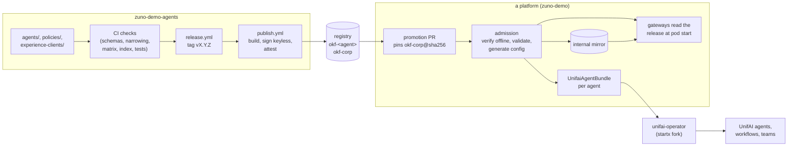

# Architecture

This repository holds **agent definitions** and the **corp policies** that bound them. A platform consumes them
from signed releases. This page shows the pieces, how a release travels to a running agent, and where each part is
documented.

## The pieces

| Piece | Where | What it is |
|---|---|---|
| Agent bundle | `agents/<name>/` | One agent as Markdown documents with YAML frontmatter, in the [Zuno OKF profile 1.0](okf-reference.md): `agent.okf.md`, `tasks/`, `prompts/`, `tools/`, `rag/`, `policies/`, `skills/`, a generated `index.md`, and its own `VERSION` |
| Experience client | `experience-clients/<name>/` | A user interface allowed to call the platform under a logical name (`client.okf.md` and the tools of each task). Not an agent: no prompt, no group, no `VERSION` |
| Corp policies | `policies/` | The ceiling for every agent: tools, knowledge domains, quotas, limits, model catalog and routing, guardrails, corp skills |
| Conformance cases | `conformance/cases/` | Release-shaped trees that every reader of the format must parse to the same result |
| Tooling | `platform/` | Schemas and checks (`okf/`, `supply-chain/`), release tooling (`release/`), the agent scaffold (`templates/agent/`) |

The format is the upstream [Open Knowledge Format 0.2](https://github.com/GoogleCloudPlatform/open-knowledge-format/blob/main/SPEC.md),
plus a namespaced `zuno` block and the constraints of the profile. An agent may only **narrow** the corp policies,
never widen them: the checks refuse a widening and name the clause it exceeds.

## From a commit to a running agent

1. **Author.** You change a bundle or a policy on `devel`. CI runs every check, and each push publishes
   `devel-<sha12>` artifacts signed with the dev identity. Dev artifacts can run on a dev cluster, but are never
   admitted as a release.
2. **Release.** A pull request from `devel` to `main` is a release. `release.yml` tags `vX.Y.Z`. Then `publish.yml`
   re-runs the checks on the tagged tree, publishes one artifact per agent plus the corp artifact, signs them
   keyless (GitHub OIDC), and attests the checks and the build provenance ([RELEASING.md](../RELEASING.md),
   [Publish, verify and roll back](publish-and-verify.md)).
3. **Pin.** A platform pins **one** thing: the digest of `okf-corp`. The corp artifact indexes the digest of every
   agent artifact, so the pin covers the whole release.
4. **Admit.** The platform verifies the signatures and attestations offline, against the identity of
   `publish.yml` on a release tag. It checks it can serve what the release asks for (models, tools, knowledge
   domains), and generates its own configuration from the release. In zuno-demo this is a promotion pull request;
   see [platform integration](https://github.com/startxfr/zuno-demo/blob/devel/docs/platform/agents-release-integration.md).
5. **Run.** The runtime turns each agent artifact into running objects. With UnifAI, a `UnifaiAgentBundle` resource
   per agent is reconciled by the operator of the startx fork: pull by digest, verify keyless, validate against
   the embedded schemas, check the ceilings, emit agents and workflows. See
   [The `UnifaiAgentBundle` resource](unifaiagentbundle.md) and the
   [operator page](https://github.com/startxfr/UnifAI/blob/devel/fork/unifai-operator/docs/okf-agent-bundles.md).

## Trust

The trust chain:
- the release identity: `publish.yml` on a `v*` tag, issued by `https://token.actions.githubusercontent.com`;
- the digest pin;
- offline verification against a committed Sigstore trusted root.

The registry is an untrusted transport: a mirror cannot change what a consumer accepts. The envelope fields of the
format (`verified`, `stale_after`, `status`) are advisory metadata; authorization comes only from the `zuno` blocks,
intersected with the corp policies and the caller's groups.

## Versions

| Version | Where | Meaning |
|---|---|---|
| OKF version | `okf_version: "0.2"` in every document and in `index.md` | The upstream format version |
| Profile version | `zuno.profile: "1.0"` in every document | The Zuno profile: the `zuno` fields and their rules. Frozen; a change is a new profile version |
| Agent version | `agents/<name>/VERSION` | Semantic version of one agent's published files |
| Release version | `VERSION` | Semantic version of the whole release, the tag `vX.Y.Z` a platform pins |

Legacy documents with `okf_version: v0.2` or `v0.3` are still read during a transition. zuno-demo refuses them from
unifai-operator line 0.2 ([okf-reference.md](okf-reference.md#legacy-versions)).

## Where each part is documented

| Repository | Page | Covers |
|---|---|---|
| zuno-demo-agents (here) | [docs/](README.md) | The format, authoring, releasing, verifying, the `UnifaiAgentBundle` fields |
| [zuno-demo](https://github.com/startxfr/zuno-demo) | [agents-release-integration.md](https://github.com/startxfr/zuno-demo/blob/devel/docs/platform/agents-release-integration.md) | How one platform pins, promotes, admits, mirrors and consumes a release |
| [UnifAI (startx fork)](https://github.com/startxfr/UnifAI) | [okf-agent-bundles.md](https://github.com/startxfr/UnifAI/blob/devel/fork/unifai-operator/docs/okf-agent-bundles.md) | How the operator reads, verifies, validates and maps a bundle, per operator version |
| Upstream | [SPEC.md](https://github.com/GoogleCloudPlatform/open-knowledge-format/blob/main/SPEC.md) | The Open Knowledge Format 0.2 |
