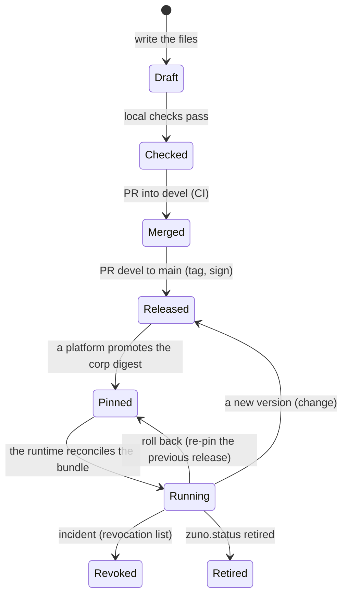

# The lifecycle of a bundle

This page follows one agent bundle from the first file to a running agent, then through changes, rollback and
retirement. Each step names the command or the page that does it.



## 1. Decide what the agent may touch

The corp policies in `policies/` are the vocabulary and the ceiling:
- tools: `tools/tool-policy.yaml`;
- knowledge domains: `knowledge/knowledge-policy.yaml`;
- model roles: `models/model-catalog.yaml`;
- limits: `limits/limits-policy.yaml`;
- quota classes: `quotas/quota-policy.yaml`;
- guardrails: `guardrails/guardrails-policy.yaml`.

A bundle may only narrow them. Adding a tool or a domain is a separate change to the corp policies, reviewed on its
own.

## 2. Write the bundle

The files and every field are in the [field reference](okf-reference.md); a step-by-step guide is in
[Add an agent](add-an-agent.md). In short:

| File | Holds |
|---|---|
| `agent.okf.md` | The agent: envelope, `zuno` block (name, status, tasks, model, access groups, display, limits) and a readable body with the generated authorization matrix |
| `tasks/<task>.md` | What one task may use: `allowed_tools`, `allowed_knowledge`, model roles, limits |
| `prompts/<task>.md` | The system prompt of the task (the body). Every task has one |
| `tools/`, `rag/`, `policies/` | Notes: how the tasks use a tool, why they read a domain, a narrowing-only constraint. Documentation, never a grant |
| `skills/<name>.md` | Reusable instructions appended to a task's prompt |
| `index.md` | Generated listing of the bundle (`generate_index.py`) |
| `VERSION` | The agent's semantic version |

## 3. Check locally

```sh
python3 platform/okf/build_profile_schemas.py --check
python3 platform/okf/validate_okf_schema.py
python3 platform/okf/generate_authorization_matrix.py --all && python3 platform/okf/generate_index.py
python3 platform/supply-chain/validate_okf_bundle.py
python3 platform/okf/check_narrowing.py
python3 platform/okf/validate_quota_policy.py
python3 platform/okf/run_agent_contract_tests.py
python3 platform/release/okf_release.py check-versions
```

Every one must print `RESULT: PASS`. A `stale_after` in the past prints a warning: review the document and move the
date.

## 4. Version and merge

Bump `agents/<name>/VERSION` when a **published** file changes ([bundle-files.md](bundle-files.md)):
- patch for a fix;
- minor for a new task, tool or domain;
- major for a removed task or a narrowed access.

Open a pull request into `devel`. CI re-runs the checks; after the merge, `publish-dev.yml` publishes
`devel-<sha12>` artifacts that a dev cluster can run.

## 5. Release

Bump the root `VERSION` and open the pull request from `devel` to `main`. The merge is the release:
1. `release.yml` tags `vX.Y.Z` and `<agent>-v<version>`;
2. `publish.yml` publishes and signs the artifacts;
3. the GitHub release gives the `okf-corp@sha256:` digest to pin.

See [RELEASING.md](../RELEASING.md) and [Publish, verify and roll back](publish-and-verify.md).

## 6. A platform adopts the release

The repository never calls a platform: the platform decides when to take a release. zuno-demo, the reference
consumer, does it in four steps:
1. a scheduled or manual workflow opens a **promotion pull request** that moves its pin and regenerates its
   configuration;
2. **admission** verifies offline and checks every model, tool and domain is servable;
3. a **mirror** copies the release into the platform's registry;
4. the gateways read the release at pod start, and the runtime reconciles one resource per agent.

Details:
[zuno-demo platform integration](https://github.com/startxfr/zuno-demo/blob/devel/docs/platform/agents-release-integration.md).

## 7. The runtime runs it

With UnifAI, each agent becomes a `UnifaiAgentBundle` resource. The startx fork of the operator:
1. pulls the artifact by digest;
2. verifies the keyless signature;
3. validates every document against its embedded schemas;
4. checks the resource's ceilings;
5. emits the agents, workflows, tools providers and team.

Field by field: [The `UnifaiAgentBundle` resource](unifaiagentbundle.md). What each operator version accepts:
[operator page](https://github.com/startxfr/UnifAI/blob/devel/fork/unifai-operator/docs/okf-agent-bundles.md).

## 8. Change, roll back, revoke, retire

- **Change.** A new version of the bundle follows steps 2 to 7. An agent whose published files did not change keeps
  its digest, so only changed agents roll.
- **Roll back.** The platform re-pins the previous release's corp digest. Nothing is ever re-tagged; a broken release
  is fixed by a new one ([publish-and-verify.md](publish-and-verify.md#roll-back)).
- **Revoke.** On an incident, the platform's revocation list stops a bundle before its next reconcile, whatever the
  pin ([unifaiagentbundle.md](unifaiagentbundle.md#revocation)).
- **Retire.** Set `zuno.status: retired` (and the upstream `status: deprecated`) in a release: the runtime withdraws
  the agent. `deprecated` keeps it served and flagged. `placeholder` declares an agent that is not served yet.

## Moving a legacy bundle to profile 1.0

A bundle written with `okf_version: v0.2` or `v0.3` is read until 2026-12-01. To move it:
1. Set `okf_version: "0.2"` and add `zuno.profile: "1.0"` to every document.
2. Replace the envelope ([mapping](okf-reference.md#from-the-legacy-envelope)).
3. Add a prompt for every task.
4. Run `generate_index.py`.

The checks above say what is left.
